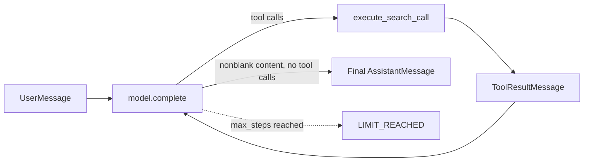

# Retrieval as a Tool Loop

A small policy assistant that lets a language model search a local handbook on demand. The model may call a `search_handbook` tool several times to refine its evidence before giving a final answer. The loop is strictly ordered and bounded by a step limit.

## Agent flow



## Project layout

```
main.py                 # search_handbook, execute_search_call, run_retrieval_loop
requirements.txt        # pytest, groq
utils/
  handbook.py           # deterministic local retriever, CONTENT_LIMIT
  models.py             # message/result dataclasses, constructors, step validator
  model_client.py       # Groq-compatible model client (GroqModel)
  tool_schema.py        # SEARCH_TOOL_SCHEMA for the search tool
```

## Components

### `search_handbook(query)`
- Passes the exact query to `HANDBOOK_RETRIEVER.invoke()`.
- Preserves document order and every chunk ID.
- Truncates each chunk's content to `CONTENT_LIMIT` (120 characters).
- Returns a `SearchEvidence` with the query and an ordered tuple of `EvidenceChunk`.

### `execute_search_call(tool_call)`
- Accepts only a tool named `search_handbook` with a nonblank string `query`.
- Invalid calls return `ToolResultMessage.invalid(tool_call)` (error `invalid_search_call`) and never search.
- Valid calls return `ToolResultMessage.from_evidence(tool_call, evidence)`.
- The original tool-call ID is always preserved.

### `run_retrieval_loop(model, user_message, max_steps)`
1. Validates `max_steps` (positive, non-boolean integer) via `validate_max_steps()`.
2. Starts the history with one `UserMessage`.
3. Calls `model.complete(messages, tools)` with the ordered message tuple and the search tool schema.
4. Appends every assistant response to the history.
5. Executes and appends each requested tool result in call order.
6. Records each successful search in the evidence trace (query and chunk-ID order preserved).
7. Continues while the model requests tools, including refined later searches.
8. Returns `RetrievalRunResult.completed(...)` on nonblank content without tool calls.
9. Returns `RetrievalRunResult.limit_reached(...)` if no answer arrives within `max_steps`.

## Run outcomes

| Status | Answer | Evidence | Messages | Model steps |
|---|---|---|---|---|
| `COMPLETED` | final answer | ordered trace | full history | steps used |
| `LIMIT_REACHED` | `None` | ordered trace | full history | exactly `max_steps` |

## Getting started

```powershell
python -m venv .venv
.venv\Scripts\Activate.ps1
pip install -r requirements.txt
```

### Use with Groq

```powershell
$env:GROQ_API_KEY = "<your key>"
$env:GROQ_MODEL = "openai/gpt-oss-120b"   # optional
python -c "from main import run_retrieval_loop; from utils.model_client import GroqModel; r = run_retrieval_loop(GroqModel(), 'How early must I request planned leave?', 4); print(r.status, r.answer, r.evidence)"
```

### Use with a mock model (no API key or network)

```python
from main import run_retrieval_loop
from utils.models import AssistantMessage, ToolCall

class FakeModel:
    def __init__(self):
        self.replies = iter([
            AssistantMessage(tool_calls=(ToolCall("c1", "search_handbook", {"query": "planned leave"}),)),
            AssistantMessage(content="Submit planned leave five working days in advance."),
        ])
    def complete(self, messages, tools):
        return next(self.replies)

result = run_retrieval_loop(FakeModel(), "How early must I request leave?", 3)
print(result.status, result.model_steps, result.evidence)
```

## Handbook retriever

`LocalHandbookRetriever` is a deterministic keyword-overlap ranker over three sample policy chunks (`leave-01`, `leave-02`, `security-01`). It returns up to two documents, ordered by score then original position, which keeps tests reproducible.

## Testing

Tests inject a mocked model and the local retriever, so no key or network is needed:

```powershell
pytest
```

## Design notes

- Evidence and messages are immutable dataclasses; the loop returns tuples so history cannot be mutated afterwards.
- Tool calls within one assistant turn run in the order requested.
- The step limit is a hard bound, so a model that keeps calling tools cannot loop forever.
